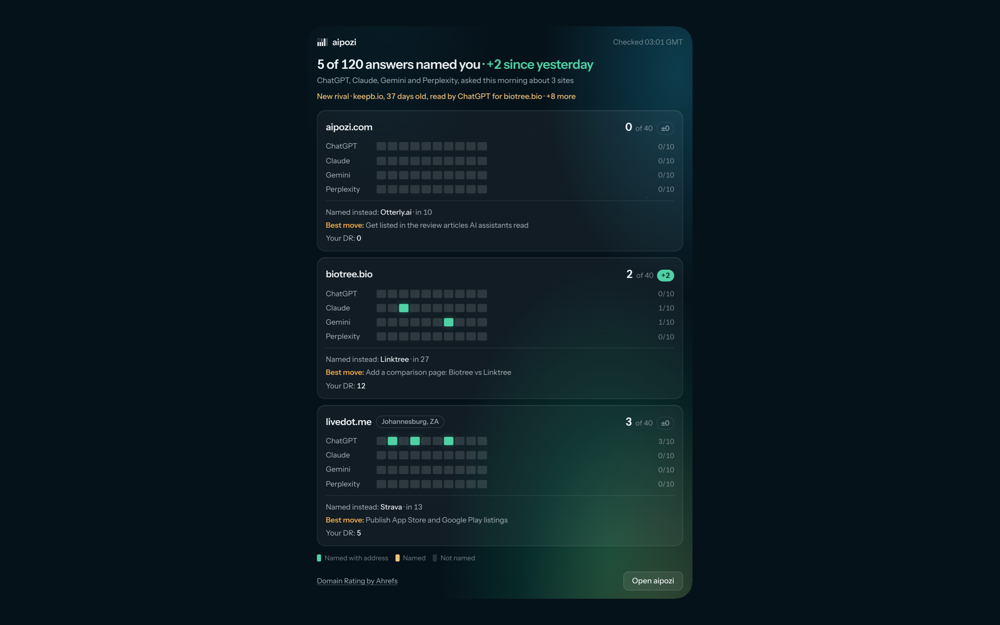
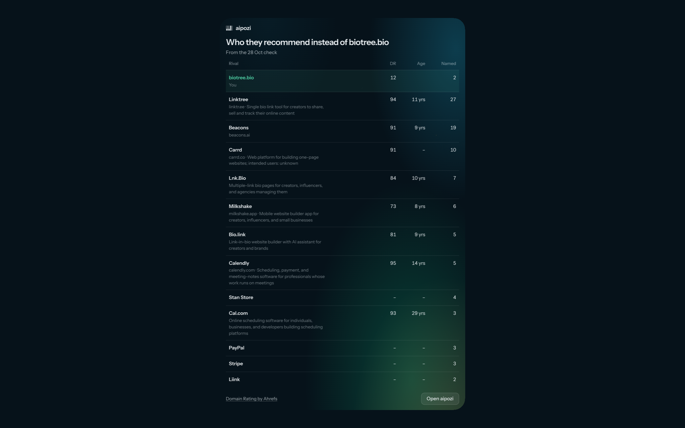
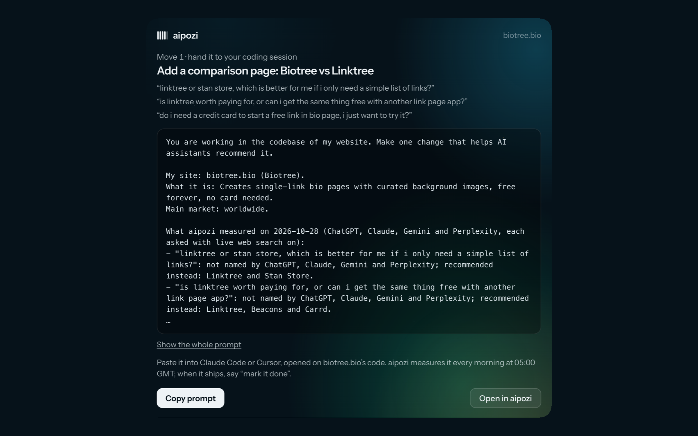

<div align="center">


# aipozi MCP

**Your AI visibility, every morning, in your AI.**

Every morning aipozi asks ChatGPT, Claude, Gemini and Perplexity the questions your customers ask, and records whether they name your website, whether they give your address, and who they recommend instead. The aipozi MCP brings that into the AI you already work in: ask for today's briefing, see who beat you and why, and hand the fix straight to your coding agent.

[](https://registry.modelcontextprotocol.io/v0/servers?search=com.aipozi)
[](https://glama.ai/mcp/connectors/com.aipozi/aipozi)
[](https://cursor.directory/plugins/aipozi)

`https://aipozi.com/mcp` · Streamable HTTP · OAuth 2.1 for your own sites · four domain tools need no sign-in

</div>



<table>
<tr>
<td width="50%"></td>
<td width="50%"></td>
</tr>
</table>

## Connect it

The server is `https://aipozi.com/mcp` (Streamable HTTP). Your own sites need an aipozi account (free first check at [aipozi.com](https://aipozi.com)); you sign in once with OAuth and choose Allow. The domain tools work without signing in.

**Claude** (web and desktop): Settings → Connectors → Add custom connector → `https://aipozi.com/mcp` → Connect.

**ChatGPT**: Settings → Apps & Connectors → Advanced settings → turn on Developer mode → Create, MCP server URL `https://aipozi.com/mcp`, authentication OAuth.

**Claude Code**
```bash
claude mcp add --transport http aipozi https://aipozi.com/mcp
```

**Cursor**: one click with [Add to Cursor](https://aipozi.com/mcp), or add this to `~/.cursor/mcp.json`:
```json
{
  "mcpServers": {
    "aipozi": { "url": "https://aipozi.com/mcp" }
  }
}
```

## Try it

- *Read me today's aipozi briefing.*
- *Who do the AIs recommend instead of me, how old are they and what's their DR?*
- *Show me exactly what Claude said for my first question.*
- *What should I improve first? Give me the build prompt for my coding session.* Then, once it has shipped: *Mark it done.*
- *Is aipozi available as a .ai? Also check namepilot and dotfinder.*
- *whois heya.page*

Ask your assistant to run the briefing every morning (a Claude scheduled task, a ChatGPT task, or `/loop` in Claude Code) and it reads it to you after the 05:00 GMT checks.

## Tools

Signed in, your own sites only (scope `sites:read`):

| Tool | What it answers |
|---|---|
| `briefing` | Today's read across your sites: named and linked out of 40, change since yesterday, per AI, questions won and lost, new rivals with age and DR, your DR, today's best move |
| `list_my_sites` | Every site with plan, market, last check, results per AI and DR |
| `questions` | One site's questions, with each AI's result today and recently |
| `ai_answer` | One AI's answer to one question, word for word as stored, with the pages it cited |
| `rivals` | Who the AIs recommend instead: what they do, domain age, Domain Rating, how often each AI named them |
| `rival_detail` | One rival up close, with the AIs' own words |
| `trend` | Named and linked counts per day and per AI over 7, 30 or 90 days, with shipped moves marked |
| `action_plan` | Why you are or are not named, and the ranked moves |
| `build_prompt` | One move as a complete brief for a coding agent (Claude Code, Cursor) |
| `mark_move_done` | Records that a move shipped (scope `moves:write`). The only write; not destructive; `undo: true` reverses it |

No sign-in:

| Tool | What it answers |
|---|---|
| `check_domain` | Is a name free? One name across many extensions, or up to 10 names at once, read live from each registry |
| `domain_age` | A WHOIS / RDAP lookup: registration date, age, registrar, expiry, status (with an estimated drop date for expiring names), name servers, host |
| `domain_rating` | Domain Rating for up to 25 domains. Domain Rating by [Ahrefs](https://ahrefs.com) |
| `ai_crawler_access` | Whether each AI's search crawler may read a site, from its robots.txt |

Prompts: `daily_briefing`, `fix_top_move`, `rival_watch`.

## How it works

- **Checks run once a day at 05:00 GMT**, never from a chat. aipozi asks each AI with live web search on, from the market you choose (worldwide, a country or a city).
- **Read-only by default.** The only write is marking a move as done in your own move log. Nothing is deleted anywhere.
- **Your data only.** Signed-in tools return only your own sites. Rivals are seen through your own questions.
- **What we store from a chat: nothing.** Each call logs the tool, the client, the time and the outcome, never the content. Details: [aipozi.com/privacy](https://aipozi.com/privacy).
- **Sign-in:** OAuth 2.1 with PKCE and dynamic client registration. Access tokens last an hour, refresh tokens 30 days and rotate; both are stored only as hashes. Disconnect any time in the app under Account → Connected apps.
  - Protected resource metadata: `https://aipozi.com/.well-known/oauth-protected-resource/mcp`
  - Authorization server metadata: `https://aipozi.com/.well-known/oauth-authorization-server`

This repository holds the public listing for the aipozi MCP: setup, tools, the [MCP Registry](https://registry.modelcontextprotocol.io) entry (`server.json`) and listing images. The server itself is aipozi's hosted service; there is nothing to install or run.

## Links

- Website and setup page: [aipozi.com/mcp](https://aipozi.com/mcp)
- Free tools: [domain search](https://aipozi.com/domains) · [website age and WHOIS](https://aipozi.com/whois)
- Guides: [aipozi.com/guides](https://aipozi.com/guides)
- Privacy: [aipozi.com/privacy](https://aipozi.com/privacy) · Terms: [aipozi.com/terms](https://aipozi.com/terms)
- Support: [hello@aipozi.com](mailto:hello@aipozi.com)
